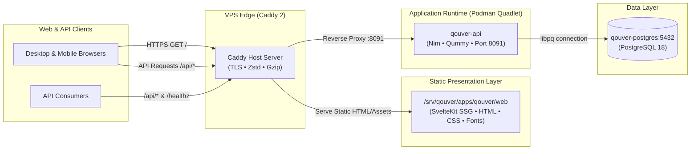

# Qouver

Umbrella home for systems and ideas: the official monorepo for [qouver.com](https://qouver.com).

## What this is

Qouver pairs a high-throughput Nim backend with a pre-rendered SvelteKit presentation layer, styled
as Direction C, a facility-signage system of condensed display type and register rows. It carries the
marketing site, the project showcase, the journal and the status pages, and the API they read from.

What it does not do: it is not a CMS. Content lives in the repository as Markdown and JSON, and a
release publishes it. There is no admin surface and no runtime editing.

## Status

Version and dependency requirements live in `qouver.nimble` (`version = "0.1.0"`, and
`requires "nim >= 2.2.6 & < 2.5.0"`). The site at qouver.com runs from `main`: a push deploys it, and the
repository carries no tags.

## Architecture



- Decoupled backend and frontend: presentation and logic are cleanly split across `apps/web` and
  `apps/api`.
- Static-first pre-rendering: every marketing, project showcase, journal and status route
  pre-renders to static HTML at build time with `@sveltejs/adapter-static`. The HTML is complete
  before any script runs; a small SvelteKit bundle then hydrates client-side navigation and the
  contact form.
- Contract-driven development: the OpenAPI 3.1 specification in `packages/contracts` is the single
  source of truth, and compiles into typed clients for the web app and for consumers.
- Native efficiency: the backend runs on compiled Nim using the evented [Qummy](https://github.com/qouver/qummy)
  server (our maintained fork of Mummy), with a low memory footprint and predictable latency.
- WCAG 2.2 AA: continuous automated accessibility verification with Playwright and
  `@axe-core/playwright`.

| Part | Language | Version |
|---|---|---|
| API | Nim + Qummy | `qouver.nimble` requires `nim >= 2.2.6 & < 2.5.0`; CI pins 2.4.2 |
| Web | SvelteKit, Svelte 5 runes, TypeScript | see `apps/web/package.json` |
| Database | PostgreSQL | 18 |

### Direction C design system

The site reads like facility signage and an equipment register: condensed display type, black and
yellow bands that code state, and rows laid out like a departure board. Reading pages drop to a
quieter sub-system in Public Sans.

| Token | Value | Role |
|---|---|---|
| White | `#FFFFFF` | Page background and panels |
| Ink | `#0A0A0A` | Text, rules, and structural borders |
| Grey | `#E9E9E6` | Quiet panels and archived rows |
| Muted | `#4A4A4A` | Secondary captions and metadata |
| Yellow | `#FFD400` | Status code for the operating state, never decoration |
| Display font | `Anton` | Self-hosted condensed face for headlines |
| Interface font | `Public Sans` | Self-hosted variable sans for body copy |

Type is eight roles with nothing below 14px, and spacing comes off the 4/8/12/16/24/32/48/64/96/128
ladder. Tokens are declared once, in `apps/web/static/styles.css`, and mirrored in `packages/ui`.

## Repository layout

```text
qouver/
├── apps/
│   ├── api/                 # Nim HTTP backend (Qummy + db_postgres)
│   │   ├── src/             # Handlers, configuration, and data access
│   │   └── tests/           # Contract parity and API unit test suites
│   └── web/                 # SvelteKit presentation app (Svelte 5 runes)
│       ├── src/routes/      # Pre-rendered routes (/, /about, /projects, /journal, /contact)
│       ├── static/          # Fonts, styles.css, robots.txt, llms.txt
│       └── tests/           # Playwright e2e & Axe accessibility tests
├── packages/
│   ├── contracts/           # OpenAPI 3.1 specification (qouver-api.yaml)
│   ├── api-client/          # Auto-generated TypeScript client (openapi-fetch)
│   └── ui/                  # Shared Direction C design tokens & constants
├── shared/
│   └── kernel/              # Shared types, models, and domain definitions
├── deploy/                  # Production deployment artifacts (Quadlets, Dockerfiles, Caddy)
├── ops/
│   ├── scripts/             # Host deployment and zero-downtime rollback scripts
│   └── webhook/             # VPS GitHub push webhook definitions
├── tools/                   # Validation, contract generation, and audit tools
├── task                     # POSIX single-door task runner
└── qouver.nimble            # Nim package specification and dependencies
```

## Local development

### Prerequisites

Nim within the `qouver.nimble` range (CI pins 2.4.2), Node with pnpm, and libpq for the backend.

### Quickstart

```sh
nimble install -y -d
pnpm install --frozen-lockfile
./task build
```

Run the API and the pre-rendered output the way `deploy/` does, or drive the site through `./task`.

## Configuration

The backend reads its DSN and listen settings from the environment (`QOUVER_DATABASE_URL`,
`QOUVER_HOST`, `QOUVER_PORT`, `QOUVER_ENV`), and the deploy scripts read `QOUVER_APP_DIR`,
`QOUVER_IMAGE_WAIT_ATTEMPTS`, `QOUVER_HEALTH_URL` and `QOUVER_API_TARGET`. Defaults and consumers live
in the deploy artifacts under `deploy/` and `ops/`; no real value is committed.

## Quality gates

All developer and CI interaction runs through the portable `./task` entry point:

```sh
./task check     # static analysis, linting, format verification, OpenAPI contract validation
./task test      # unit and contract tests (Nim backend & TypeScript packages)
./task build     # compile the Nim release binary and pre-render the SvelteKit site
./task ci-fast   # check + test + build, no browsers (the CI `verify` job)
./task ci        # the complete gate matrix required before merging
```

CI runs `./task ci-fast` plus a separate job that installs Playwright and runs `./task e2e`, so
a slow browser install cannot cancel the Nim and unit-test half of the gate. `./task ci` is still
the one command a laptop runs before a pull request.

## Deployment

Deployments run alongside the other systems on Rocky Linux.

A new host needs one credential first: `ghcr.io/qouver/qouver-{api,web}` are private, so the
deploy user needs a GHCR credential with `read:packages` in `~/.config/containers/auth.json`. The
script pulls as that user, and a pull that fails on auth aborts at once instead of waiting for a
missing tag.

1. GitHub push webhook: pushes to `main` deliver an HMAC-SHA256 authenticated event to
   `https://api.qouver.com/hooks/qouver`.
2. Signed pulls: the API and web images are pulled from `ghcr.io/qouver/qouver-{api,web}:sha-<short>`,
   their revision label and cosign signature verified, then retagged `:local` / `:prev`. Web assets
   are extracted from the verified image and swapped atomically into `/srv/qouver/apps/qouver/web`;
   by default the host builds nothing. `BUILD_MODE=host ./ops/scripts/deploy-vps.sh` is the manual
   escape hatch that compiles the API image on the host, for the day GitHub or the registry is down.
3. Health gate and rollback: the script polls `http://127.0.0.1:8091/healthz` and requires it to
   report the revision being deployed. If unhealthy, the previous API image and web assets
   (`.prev`) are restored automatically.
4. Caddy host routing: static routes are served directly by Caddy's `file_server` (SELinux
   `httpd_sys_content_t`); `/api/*` and `/healthz` are reverse-proxied to internal port `8091`.

## Documentation

There is no `docs/` directory and no `DESIGN.md` at the root yet. Until there is, the design direction
is the token table above and the decisions are the reasoning found in `packages/ui` and the app
sources.

## Security

Do not open a public issue for a vulnerability. Reporting channel, what to include and what is in
scope are in [`SECURITY.md`](SECURITY.md); GitHub private vulnerability reporting is enabled on this
repository and is the channel it names.

## Contributing

Fork, branch, pull request against `main`, and keep `./task ci` green before you open it. Commit
messages follow Conventional Commits. Build steps, what a change must pass, and what not to send are
in [`CONTRIBUTING.md`](CONTRIBUTING.md).

## License

Distributed under the [MIT License](LICENSE). The license covers the code only: the Qouver name,
brand, and the site content are carved out in the same file.
