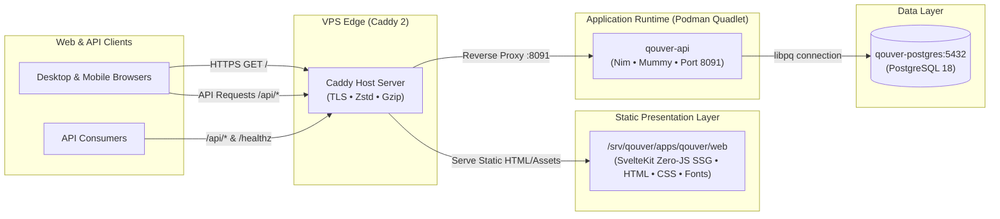

# Qouver

Umbrella home for systems and ideas: the official monorepo for [qouver.com](https://qouver.com).

## What this is

Qouver pairs a high-throughput Nim backend with a pre-rendered SvelteKit presentation layer, styled
under the bespoke Workshop Broadsheet editorial aesthetic. It carries the marketing site, the project
showcase, the journal and the status pages, and the API they read from.

What it does not do: it is not a CMS. Content lives in the repository as Markdown and JSON, and a
release publishes it. There is no admin surface and no runtime editing.

## Status

Version `VERSION`-equivalent lives in `qouver.nimble` (`version = "0.1.0"`) and is not tagged. The
site at qouver.com runs from `main`; a push deploys it.

## Architecture



- Decoupled backend and frontend: presentation and logic are cleanly split across `apps/web` and
  `apps/api`.
- Zero-JS static pre-rendering: every marketing, project showcase, journal and status route
  pre-renders to static HTML at build time with `@sveltejs/adapter-static`, for performance, SEO and
  resilience.
- Contract-driven development: the OpenAPI 3.1 specification in `packages/contracts` is the single
  source of truth, and compiles into typed clients for the web app and for consumers.
- Native efficiency: the backend runs on compiled Nim using the evented [Mummy](https://github.com/guzba/mummy)
  server, with a low memory footprint and predictable latency.
- WCAG 2.2 AA: continuous automated accessibility verification with Playwright and
  `@axe-core/playwright`.

| Part | Language | Version |
|---|---|---|
| API | Nim + Mummy | `qouver.nimble` requires `nim >= 2.2.0 & < 2.5.0`; CI pins 2.4.2 |
| Web | SvelteKit, Svelte 5 runes, TypeScript | see `apps/web/package.json` |
| Database | PostgreSQL | 18 |

### Workshop Broadsheet design system

The visual identity is modeled on traditional craftsmanship, technical broadsheets and editorial
typography:

| Token | Value | Role |
|---|---|---|
| Bone Paper | `#EDEAE3` | Primary page background; warm, tactile parchment substrate |
| Ink | `#141311` | Primary text and structural borders |
| Ink Light | `#5C5852` | Secondary captions, metadata, editorial timestamps |
| Oxide Accent | `#B23A1A` | Industrial terracotta oxide; active highlights and status accents |
| Border Dark | `#24221E` | High-contrast structural division lines |
| Display font | `Fraunces` | Self-hosted serif, variable optical size for headlines |
| Interface font | `Archivo` | Self-hosted grotesque sans-serif, technical body copy |

## Repository layout

```text
qouver/
├── apps/
│   ├── api/                 # Nim HTTP backend (Mummy + db_postgres)
│   │   ├── src/             # Handlers, configuration, and data access
│   │   └── tests/           # Contract parity and API unit test suites
│   └── web/                 # SvelteKit presentation app (Svelte 5 runes)
│       ├── src/routes/      # Pre-rendered routes (/, /about, /projects, /journal, /contact)
│       ├── static/          # Fonts, styles.css, robots.txt, llms.txt
│       └── tests/           # Playwright e2e & Axe accessibility tests
├── packages/
│   ├── contracts/           # OpenAPI 3.1 specification (qouver-api.yaml)
│   ├── api-client/          # Auto-generated TypeScript client (openapi-fetch)
│   └── ui/                  # Shared Broadsheet design tokens & constants
├── shared/
│   └── kernel/              # Shared types, models, and domain definitions
├── deploy/                  # Production deployment artifacts (Quadlets, Dockerfiles, Caddy)
├── ops/
│   ├── scripts/             # Host deployment and zero-downtime rollback scripts
│   └── webhook/             # VPS GitHub push webhook definitions
├── tools/                   # Validation, contract generation, and audit tools
├── task                     # POSIX single-door task runner
└── qouver.nimble            # Nim package specification and dependencies
```

## Local development

### Prerequisites

Nim within the `qouver.nimble` range (CI pins 2.4.2), Node with pnpm, and libpq for the backend.

### Quickstart

```sh
nimble install -y -d
pnpm install --frozen-lockfile
./task build
```

Run the API and the pre-rendered output the way `deploy/` does, or drive the site through `./task`.

## Configuration

The backend reads its DSN and listen settings from the environment (`QOUVER_DATABASE_URL`,
`QOUVER_HOST`, `QOUVER_PORT`, `QOUVER_ENV`), and the deploy scripts read `QOUVER_APP_DIR`,
`QOUVER_IMAGE_WAIT_ATTEMPTS`, `QOUVER_HEALTH_URL` and `QOUVER_API_TARGET`. Defaults and consumers live
in the deploy artifacts under `deploy/` and `ops/`; no real value is committed.

## Quality gates

All developer and CI interaction runs through the portable `./task` entry point:

```sh
./task check     # static analysis, linting, format verification, OpenAPI contract validation
./task test      # unit and contract tests (Nim backend & TypeScript packages)
./task build     # compile the Nim release binary and pre-render the SvelteKit site
./task ci        # the complete gate matrix required before merging
```

CI runs `./task ci` plus a security job and the shared golden CI/CD contract check.

## Deployment

Deployments run alongside the other systems on Rocky Linux:

1. GitHub push webhook: pushes to `main` deliver an HMAC-SHA256 authenticated event to
   `https://api.qouver.com/hooks/qouver`.
2. Atomic in-place build: web assets are compiled with `corepack pnpm` and swapped atomically into
   `/srv/qouver/apps/qouver/web`; the API image `localhost/qouver-api:local` is built locally with
   Podman.
3. Health gate and rollback: the script polls `http://127.0.0.1:8091/healthz`. If unhealthy, the
   previous API image and web assets (`.prev`) are restored automatically.
4. Caddy host routing: static routes are served directly by Caddy's `file_server` (SELinux
   `httpd_sys_content_t`); `/api/*` and `/healthz` are reverse-proxied to internal port `8091`.

## Documentation

There is no `docs/` directory yet. The decisions and the design direction live in `DESIGN.md` at the
root and in the code comments of `packages/`, and each app carries its own README.

## Security

Do not open a public issue for a vulnerability. The repository does not carry a `SECURITY.md` yet, so
report privately through GitHub: open the repository's **Security** tab and use
**Report a vulnerability**. That route is private between you and the maintainer.

## Contributing

Fork, branch, pull request against `main`, and keep `./task ci` green before you open it. Commit
messages follow Conventional Commits. There is no `CONTRIBUTING.md` yet, so this paragraph is the
whole convention.

## License

Distributed under the [MIT License](LICENSE). The license covers the code only: the Qouver name,
brand, and the site content are carved out in the same file.
