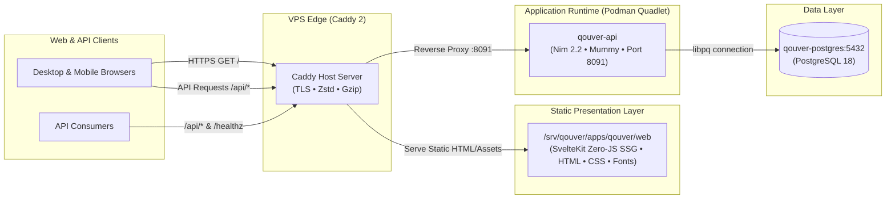

# Qouver

[](https://github.com/nferdazel/qouver/actions)
[](LICENSE)
[](https://nim-lang.org)
[](https://svelte.dev)
[](https://www.typescriptlang.org)
[](https://www.postgresql.org)

**Umbrella home for systems and ideas.**

Official monorepo for [qouver.com](https://qouver.com). Built with a decoupled architecture pairing a high-throughput **Nim 2.2** backend with a pre-rendered **SvelteKit (Svelte 5 Runes)** presentation layer, styled under the bespoke *Workshop Broadsheet* editorial aesthetic.

---

## Architecture Overview



### Highlights

- **Decoupled Backend & Frontend:** Presentation and logic are cleanly split across `apps/web` and `apps/api`.
- **Zero-JS Static Pre-rendering:** All marketing, project showcase, journal, and status routes pre-render to static HTML at build time with `@sveltejs/adapter-static` for maximum performance, SEO, and resilient reliability.
- **Contract-Driven Development:** OpenAPI 3.1 specification (`packages/contracts`) acts as the single source of truth, compiling directly into typed client libraries for web and consumers.
- **Native Efficiency:** Backend runs on compiled Nim using the evented [Mummy](https://github.com/guzba/mummy) web server, yielding low memory footprints and predictable sub-millisecond response latencies.
- **WCAG 2.2 AA Compliance:** Continuous automated accessibility verification powered by Playwright and `@axe-core/playwright`.

---

## Workshop Broadsheet Design System

The visual identity is modeled on traditional craftsmanship, technical broadsheets, and editorial typography:

| Token | Value | Role |
| :--- | :--- | :--- |
| **Bone Paper** | `#EDEAE3` | Primary page background; warm, tactile parchment substrate |
| **Ink** | `#141311` | Primary text and structural borders; sharp and legible |
| **Ink Light** | `#5C5852` | Secondary captions, metadata, and editorial timestamps |
| **Oxide Accent** | `#B23A1A` | Industrial terracotta oxide; active highlights and status accents |
| **Border Dark** | `#24221E` | High-contrast structural division lines |
| **Display Font** | `Fraunces` | Self-hosted serif; variable optical size for headlines |
| **Interface Font** | `Archivo` | Self-hosted grotesque sans-serif; technical body copy |

---

## Monorepo Layout

```text
qouver/
├── apps/
│   ├── api/                 # Nim 2.2 HTTP backend (Mummy + db_postgres)
│   │   ├── src/             # Handlers, configuration, and data access
│   │   └── tests/           # Contract parity and API unit test suites
│   └── web/                 # SvelteKit presentation app (Svelte 5 runes)
│       ├── src/routes/      # Pre-rendered routes (/, /about, /projects, /journal, /contact)
│       ├── static/          # Fonts, styles.css, robots.txt, llms.txt
│       └── tests/           # Playwright e2e & Axe accessibility tests
├── packages/
│   ├── contracts/           # OpenAPI 3.1 specification (qouver-api.yaml)
│   ├── api-client/          # Auto-generated TypeScript client (openapi-fetch)
│   └── ui/                  # Shared Broadsheet design tokens & constants
├── shared/
│   └── kernel/              # Shared types, models, and domain definitions
├── deploy/                  # Production deployment artifacts (Quadlets, Dockerfiles, Caddy)
├── ops/
│   ├── scripts/             # Host deployment and zero-downtime rollback scripts
│   └── webhook/             # VPS GitHub push webhook definitions
├── tools/                   # Validation, contract generation, and audit tools
├── task                     # POSIX single-door task runner
└── qouver.nimble            # Nim package specification and dependencies
```

---

## POSIX Task Runner (`./task`)

All developer and CI interactions run through the portable `./task` entry point:

```sh
./task check     # Static analysis, linting, format verification, and OpenAPI contract validation
./task test      # Run unit and contract tests (Nim backend & TypeScript packages)
./task build     # Compile Nim release binary and pre-render SvelteKit static site
./task e2e       # Execute headless Playwright integration and WCAG 2.2 AA accessibility suite
./task ci        # Run the complete test and gate matrix required before merging
```

---

## Deployment & Operations

Deployments run uniformly alongside other ecosystem systems on Rocky Linux:

1. **GitHub Push Webhook:** Pushes to `main` deliver an HMAC-SHA256 authenticated event to `https://api.qouver.com/hooks/qouver`.
2. **Atomic In-Place Build:**
   - Web assets are compiled with `corepack pnpm` and swapped atomically into `/srv/qouver/apps/qouver/web`.
   - API image `localhost/qouver-api:local` is built locally with Podman.
3. **Health Gate & Rollback:** The script polls `http://127.0.0.1:8091/healthz`. If unhealthy, the previous API container image and web assets (`.prev`) are restored automatically.
4. **Caddy Host Routing:**
   - Static routes → served directly via Caddy's `file_server` (SELinux `httpd_sys_content_t`).
   - `/api/*` and `/healthz` → reverse-proxied to internal port `8091`.

---

## License

Distributed under the [MIT License](LICENSE).
